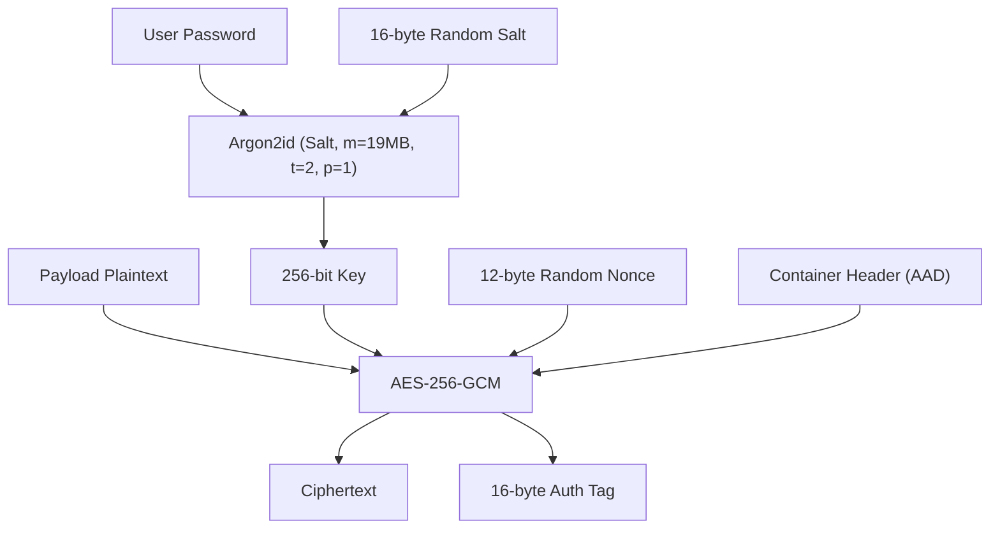
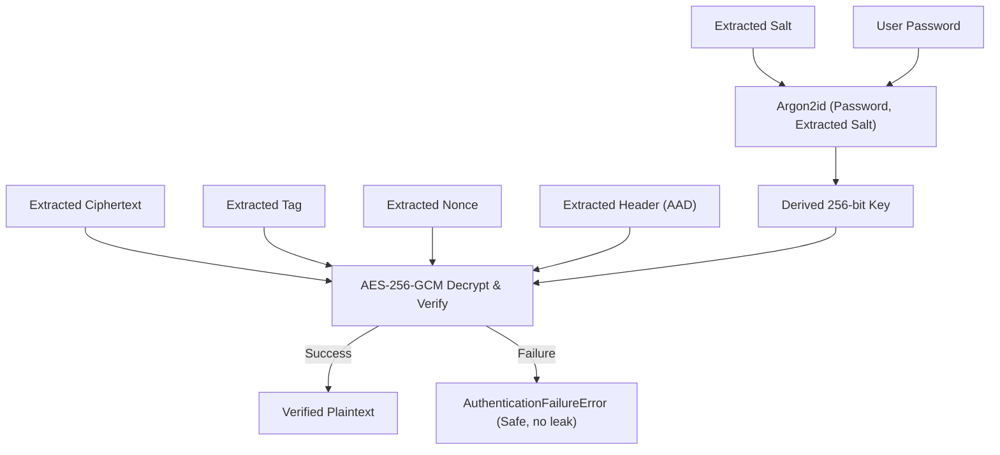

# Cryptography Architecture and Specifications

## 1. Overview

StegoEngine provides authenticated confidentiality for steganographic payloads. Steganography alone hides the *presence* of communication; cryptography provides *confidentiality* and *integrity* against adversaries who inspect or extract the carrier data.

No custom cryptographic primitives are implemented. All cryptographic operations utilize vetted, reviewed primitives via the `cryptography` Dart package.

---

## 2. Algorithms and Primitives

### 2.1 Authenticated Encryption: AES-256-GCM

- **Cipher:** Galois/Counter Mode (GCM) with 256-bit key (AES-256-GCM).
- **Key Length:** 32 bytes (256 bits).
- **Nonce / IV Length:** 12 bytes (96 bits), uniquely generated per encryption operation using a cryptographically secure pseudorandom number generator (`Random.secure()`). Nonce reuse is strictly prevented.
- **Authentication Tag Length:** 16 bytes (128 bits).
- **Associated Data (AAD):** The entire container header preceding the ciphertext (magic, version, flags, payload type, salt, nonce, and declared payload length) is supplied as AAD. This guarantees that header parameters cannot be manipulated without causing an authentication error.

### 2.2 Password-Based Key Derivation: Argon2id

- **KDF:** Argon2id (hybrid data-dependent and data-independent memory-hard function), resistant to GPU/ASIC attacks and side-channel timing attacks.
- **Parameters:**
  - **Memory Cost ($m$):** 64 MB ($65,536$ KiB) for robust security, with mobile-friendly configurations down to 19 MB ($19,456$ KiB) supported. Default: 19 MB for broad mobile/desktop compatibility.
  - **Time Cost / Iterations ($t$):** 2 passes.
  - **Parallelism ($p$):** 1 lane (guarantees deterministic derivation across single-threaded and multi-core platforms).
  - **Salt Length:** 16 bytes (128 bits), fresh CSPRNG-generated per encryption.
  - **Output Key Length:** 32 bytes (256 bits).

---

## 3. Cryptographic Operations Workflow

### 3.1 Encryption Workflow

### 3.2 Decryption Workflow

---

## 4. Security Guarantees & Constraints

1. **No Unauthenticated Plaintext:** The decoder never returns or partially displays decrypted plaintext if the authentication tag check fails.
2. **Safe Error Responses:** Cryptographic failures return a generic `AuthenticationFailureResult` / `AuthenticationFailureError`. Timing differences and internal cipher state are not exposed.
3. **No Key / Password Persistence:** Keys and passwords are never logged, persisted to disk, or retained in memory longer than necessary.
4. **Fresh Salt & Nonce:** Every encrypted payload generates fresh 16-byte salt and 12-byte nonce via `Random.secure()`.

